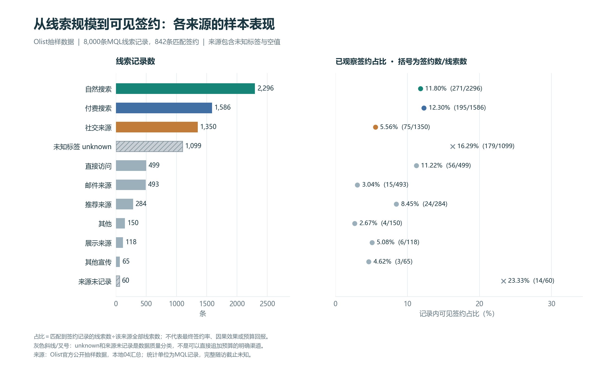
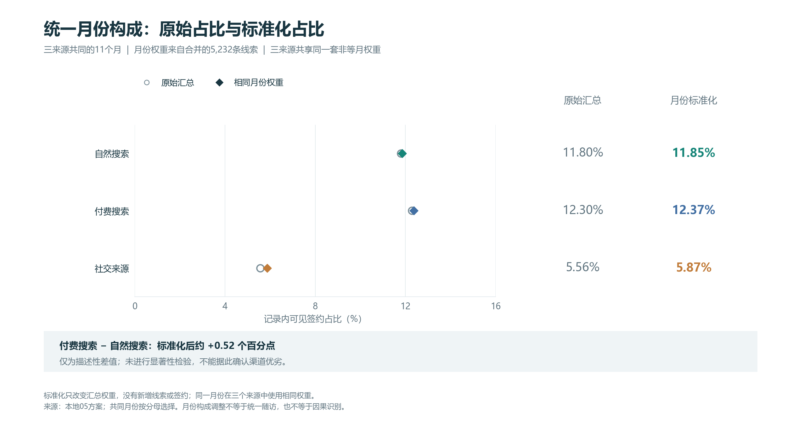

# 多渠道营销线索评估与投放预算策略比较

## 目录导航
- [个人背景与项目动机](#个人背景与项目动机)
- [项目亮点](#项目亮点)
- [项目目录](#项目目录)
- [先看结论](#先看结论)
- [数据与方法参考](#数据与方法参考)

**直接对比各渠道原始转化数据容易被每月流量波动干扰，校正之后，能不能公平判断哪个渠道的客户质量更好，指导广告预算怎么分配？**
基于 Olist 电商线索公开数据集的个人学习研究项目。使用 SQL 提取渠道数据、分层标准化校正月度波动、多轮检验验证结论稳定性，把渠道投放评估业务问题和预算决策、埋点数据排查结合；代码、结果表、图表和运行规则均保留。适用于展示多渠道营销投放评估与数据治理分析思路。

## 个人背景与项目动机

本人统计学专业，拥有市场方向实习经历。在市场业务实践中发现，渠道效果评估常直接使用原始转化率对比，忽略月度样本分布差异带来的评估偏差，容易误判渠道真实线索质量。本项目从该业务痛点出发，结合分层标准化、敏感性检验等统计方法，公平评估多渠道线索转化效果，定位埋点数据问题，为广告预算分配提供决策依据。

## 项目亮点

1. 解决**月度样本分布不均衡**带来的渠道评估偏差问题，使用分层标准化得到公平可比的渠道转化指标，支撑营销预算分配决策；
2. 使用分层抽样、协变量校验、敏感性稳健性检验，不只输出单点指标，验证结论稳定性，发挥统计学专业优势；
3. 完成数据埋点异常溯源，定位未知来源流量对应的落地页问题，把数据分析落地到数据治理与埋点优化；
4. 完整工程链路：数据清洗、SQL 指标提取、分层校正、脏数据审计、可视化、稳健性检验，全程规避数据泄露。

Python・pandas・matplotlib・SQL・sqlite・分层标准化・敏感性检验

## 项目目录

```
├── 01_read_and_audit.py            # 数据读取、清洗、EDA探索性分析
├── 02_build_database.py            # 构建本地sqlite数据库
├── 03_run_sql.py                   # SQL批量查询，渠道基础指标提取
├── 04_channel_metrics.py           # 渠道原始转化指标计算
├── 05_month_standardization.py     # 月份分层标准化，校正月度分布偏差
├── 06_time_diagnostics.py          # 用户签约时长、时间维度探索分析
├── 07_plot_project.py              # 结果可视化绘图
├── 07_prepare_plotting.py          # 绘图数据预处理
├── 09_landing_source_audit.py      # Unknown未知来源落地页脏数据审计
├── 10_sensitivity_analysis.py      # 稳健性敏感性检验，验证结论稳定性
├── data/                           # 项目精简数据集
├── sql/                            # SQL查询脚本
├── reports/                        # 实验输出：指标csv、可视化图表、分析文档
├── docs/                           # 字段说明、指标边界文档
├── requirements-plotting.txt       # 项目依赖清单
└── .gitignore
```

## 先看结论

| 来源 | 线索记录数 | 匹配签约数 | 已观察签约占比 | 月份标准化后 |
| --- | ---: | ---: | ---: | ---: |
| 自然搜索 | 2,296 | 271 | 11.80% | 11.85% |
| 付费搜索 | 1,586 | 195 | 12.30% | 12.37% |
| 社交来源 | 1,350 | 75 | 5.56% | 5.87% |

- 自然搜索的线索和匹配签约数量在各来源中最多；付费搜索的已观察签约占比略高于自然搜索。
- 给三个来源使用同一套月份权重后，描述性排序保持一致。付费搜索减自然搜索约为0.52个百分点，尚未检验统计显著性。
- `unknown`有1,099条，其中656条集中在同一个匿名落地页，占全部unknown的59.69%。该页共912条线索，unknown与空白合计657条，占页内72.04%，可明确优先回查对象。空白来源60条分布于44个页ID，另行诊断。
- 排除日期异常、限制小样本月份、原共同月份等权这三种检查下，来源排序保持一致；付费搜索减自然搜索的差值分别约0.56、0.53、0.94个百分点。等权改变了比较目标，差值大小仍依赖设定。
- 841条日期有效的已观察签约记录中，日历时长中位数14天，P90为162天；30天内554条，占65.87%。这些统计只描述已观察签约者。

已观察签约占比＝该组匹配到签约记录的MQL数÷该组全部MQL记录数。整体为842÷8,000＝10.53%；其余7,158条仅表示未匹配到签约记录。完整随访截止未知，以上占比不能解释为最终签约概率或渠道因果效果。



### 项目局限
1. 数据局限：使用Olist公开电商数据集，只有订单成交结果，**缺少广告投放成本、曝光点击数据**，只能评估转化质量，无法直接计算ROI，不能完整衡量渠道投放收益。
2. 混杂因素：仅校正了月度流量波动，仍存在用户自发购买、节假日大促等未完全剥离的干扰因素，无法做到完全随机对照实验的因果推断。
3. 时间边界：数据时间跨度有限，仅覆盖一段固定周期，结论只适用于该时期巴西电商环境，直接迁移到其他国家、不同销售周期会存在偏差。
4. 维度不足：缺少广告创意、投放时段、落地页等渠道内部细分信息，只能做到渠道大类评估，无法定位渠道内部哪类投放素材效果更好。
5. 样本问题：部分小众渠道订单样本量小，分层统计后置信区间偏宽，结论的稳定性弱于头部大流量渠道。

### 后续优化方向
1. 指标完善：补充广告花费数据，增加ROI、CAC（获客成本）指标，从单纯看转化率升级为看投放收益。
2. 因果方法升级：使用双重差分DID、倾向得分匹配进一步剥离节假日、季节性干扰，提升渠道效应估计可信度。
3. 细粒度拆解：在渠道下继续拆分投放时段、商品品类，找到渠道内高转化细分人群。
4. 时序预测：搭建时序模型，预测不同渠道在未来月份的流量与转化，辅助预算动态分配。
5. A/B实验落地：后续在业务侧设计对照实验，验证本分析得出的渠道结论，检验结论真实有效性。

## 业务建议与证据

| 建议 | 现有证据 | 后续验证方式 |
| --- | --- | --- |
| 优先核查来源标签 | unknown的59.69%集中在同一匿名页；该页标签不明657／912 | 先映射该页ID并核对来源字典、采集／映射规则；空白来源另行回查，尚未证明故障 |
| 排查社交线索的质量与承接 | 1,350条线索，月份标准化后占比5.87% | 补采全部线索的获客时特征、首次响应及跟进记录，再比较并设计小范围试验 |
| 补齐跟进状态与抽取口径 | 已观察签约者时长存在长尾，未匹配者的后续状态未知 | 记录逐线索最后跟进日期、失单状态和完整数据截止，确认可比较的观察窗口 |

这些是待验证的建议，尚无已实现的签约提升或预算收益。缺少成本、实际利润和完整触点，本项目不计算ROI、最优预算或多触点归因。

## 分析过程与文件

| 步骤 | 工作 | 可查看的文件 |
| --- | --- | --- |
| 01 数据检查 | 核查表粒度、主键、缺失、日期与原始哈希 | [数据检查报告](reports/01_数据检查结果.md) |
| 02 取数与连接 | 从全部MQL出发LEFT JOIN，连接后仍为8,000条 | [建库代码](02_build_database.py)、[SQL入门结果](reports/02_SQL入门结果.md) |
| 03 独立SQL | 按首次联系月份分组、计数与排序 | [练习SQL](sql/03_monthly_leads.sql)、[月度结果](reports/03_月度线索SQL结果.md) |
| 04 指标体系 | 建立渠道及首次联系月份×渠道指标表 | [渠道SQL](sql/04_channel_metrics.sql)、[指标报告](reports/04_渠道签约指标.md) |
| 05 月份比较 | 用共同月份的合并样本构成进行直接标准化 | [标准化SQL](sql/05_month_standardization.sql)、[调整结果](reports/05_月份构成对齐.md) |
| 06 时间诊断 | 检查日期覆盖及有效已签约者日历时长 | [时间诊断](reports/06_时间与记录覆盖诊断.md) |
| 07 可视化 | 从已保存JSON生成四张PNG／SVG | [绘图代码](07_plot_project.py)、[图表说明](reports/figures/07_图表阅读与复现.md) |
| 08 业务表达 | 将证据、假设和行动建议分开 | [业务总结与建议](reports/08_业务总结与建议.md) |
| 09 来源定位 | 将unknown和空白分别下钻到匿名落地页与月份 | [诊断SQL](sql/09_landing_source_pages.sql)、[定位报告](reports/09_来源标签与落地页诊断.md) |
| 10 稳健性检查 | 对日期异常、月份小样本和权重目标分别作敏感性对照 | [方案SQL](sql/10_sensitivity_details.sql)、[稳健性报告](reports/10_稳健性分析.md) |

核心工具：Python 3.12、SQLite、SQL、Matplotlib 3.10.8。SQL练习包括LEFT JOIN、CASE WHEN、GROUP BY、CTE和窗口函数。

## 六张图

1. [来源规模与已观察签约占比](reports/figures/07_01_channel_volume_rate.png)：数量与占比一起看。
2. [月份标准化](reports/figures/07_02_month_standardization.png)：检查月份构成调整后结果是否改变。
3. [月度比较](reports/figures/07_03_monthly_comparison.png)：上图是月内占比，下图是三个指定来源的线索数量。
4. [有效已签约者时长](reports/figures/07_04_observed_won_duration.png)：只描述841条日期有效、已观察签约记录。
5. [来源标签定位](reports/figures/09_01_landing_source_diagnosis.png)：按unknown数量定位优先回查页，保留来源空白的独立诊断。
6. [稳健性方案对照](reports/figures/10_01_sensitivity_comparison.png)：比较排序、差值和覆盖范围随设定怎样变化。



## 两项深入分析

**来源标签定位。** 全部495个匿名落地页ID中，页001有656条unknown，占该类总数59.69%；同页空白1条。来源空白在全样本分布于44个ID，与unknown的集中模式不同。报告保留全量页面、样本量及月内占比，避免只按小分母高比例排名。当前只能定位回查优先级，尚未确认埋点故障或修复收益。

**描述性稳健性检查。** 以下三项各相对05主方案单独变化，不累计叠加：

| 方案 | 共同月份数 | 三来源支持记录数 | 自然搜索 | 付费搜索 | 社交来源 | 付费−自然（百分点） |
| --- | ---: | ---: | ---: | ---: | ---: | ---: |
| 05主方案 | 11 | 5,232 | 11.85% | 12.37% | 5.87% | +0.52 |
| 排除日期异常整条MQL | 11 | 5,231 | 11.81% | 12.37% | 5.87% | +0.56 |
| 每来源每月至少20条 | 10 | 5,110 | 12.13% | 12.67% | 6.01% | +0.53 |
| 原共同月份等权 | 11 | 5,232 | 8.36% | 9.29% | 4.53% | +0.94 |

差值由未舍入占比计算后再四舍五入，可能与表中显示值相减略有不同。

排序在这三项检查中保持一致，差值幅度随目标改变。20条门槛不保证统计充分性；等权方案让各月份同等重要，5,232是支持记录数。以上不证明统计显著性或因果优势，也未解决完整随访未知的问题。

## 关键口径

- 一行MQL代表一条营销线索记录。不同`mql_id`不保证是不同商家，不能把8,000条记录写成8,000家独立商户或消费者订单。
- 原始CSV不删行、不填补或改写。数据库将空白字段映射为NULL，`unknown`仍为单独的原始标签。
- 1条日期冲突仍在04／05的匹配签约计数内；仅在06的时长分布中单列，因此842条匹配签约对应841条有效时长。
- 10中的去异常方案仅在该次计算中移除异常整条MQL，同时减少分子和分母并重算权重；04／05主结果与原CSV保持不变。
- 标准化采用2017-07至2018-05的11个共同首次联系月份，权重来自三个指定来源合并的5,232条线索。同一个月份对三个来源使用相同权重，各个月份的权重可以不同。此调整没有新增签约，也没有统一随访完整性。
- 文件缺少完整销售阶段日志，当前只分析“线索—匹配签约”两个可见节点。未建立完整销售漏斗、留存分析、因果归因或算法模型。

详细规则见[项目问题与指标边界](项目问题与指标边界.md)。

## 本地复现

以下命令针对Windows PowerShell。在项目根目录运行；先用`python --version`确认当前Python为3.12。数据库由脚本生成，不需要另装MySQL。

首次使用时创建项目虚拟环境：

```powershell
python --version
python -m venv .venv-olist
```

然后依次运行：

```powershell
& ".\.venv-olist\Scripts\python.exe" -B .\01_read_and_audit.py
& ".\.venv-olist\Scripts\python.exe" -B .\02_build_database.py
& ".\.venv-olist\Scripts\python.exe" -B .\03_run_sql.py
& ".\.venv-olist\Scripts\python.exe" -B .\04_channel_metrics.py
& ".\.venv-olist\Scripts\python.exe" -B .\05_month_standardization.py
& ".\.venv-olist\Scripts\python.exe" -B .\06_time_diagnostics.py
& ".\.venv-olist\Scripts\python.exe" -B .\07_prepare_plotting.py
& ".\.venv-olist\Scripts\python.exe" -B .\07_plot_project.py
& ".\.venv-olist\Scripts\python.exe" -B .\09_landing_source_audit.py
& ".\.venv-olist\Scripts\python.exe" -B .\10_sensitivity_analysis.py
```

01—06仅用Python标准库；07、09、10绘图使用`requirements-plotting.txt`声明的依赖。07准备脚本首次安装需要联网，使用项目虚拟环境，并把安装临时目录和绘图缓存放在项目目录，关闭pip下载缓存。已装好绘图库后，原四图运行`07_plot_project.py`重画；09／10各自重新生成对应分析及图。

也可在VS Code选择本项目的`.venv-olist`解释器，再依次打开脚本点击运行。图像保存在`reports/figures`；08是汇总分析结果的Markdown文档，直接预览即可。展示包含本地运行结果，重跑会更新相应报告；不包含虚拟环境、缓存或可再生成的SQLite数据库。

SQL输出会核对原始CSV，报告记录实际执行的SQL、来源哈希和相关检查。分阶段报告中的绝对路径和时间戳来自生成环境，重跑后会更新；项目内链接使用相对路径。除Matplotlib外的间接依赖未完全锁定，不承诺跨环境图像逐字节相同。

## 数据来源、许可与协作说明

- 数据来源：[Olist官方Kaggle发布页](https://www.kaggle.com/datasets/olistbr/marketing-funnel-olist)、[Olist官方背景说明](https://github.com/olist/work-at-olist-marketing)。发布方说明为真实、匿名化、随机抽样的商家营销线索数据；本项目未独立审计其原始采集流程。
- 数据许可：[CC BY-NC-SA 4.0](https://creativecommons.org/licenses/by-nc-sa/4.0/)。原始文件、版本和校验说明见[data/raw/SOURCE.md](data/raw/SOURCE.md)，请保留署名、来源及许可说明。
- 代码许可范围：仓库根目录的MIT许可证仅适用于本项目提供的Python／SQL代码，不对Olist第三方数据和原始资料重新授权。数据及其分析导出、图表继续保留Olist署名、来源和原许可说明。
- SQL、Python代码、图表和文档由AI协助准备，学习者在本地运行并逐步学习分析口径。独立理解和编写能力需通过现场解释或练习证明，不把AI提供的代码全部表述为独立开发。
- 本项目是公开数据练习，与Olist无隶属关系，无企业上线或业务提升业绩。

