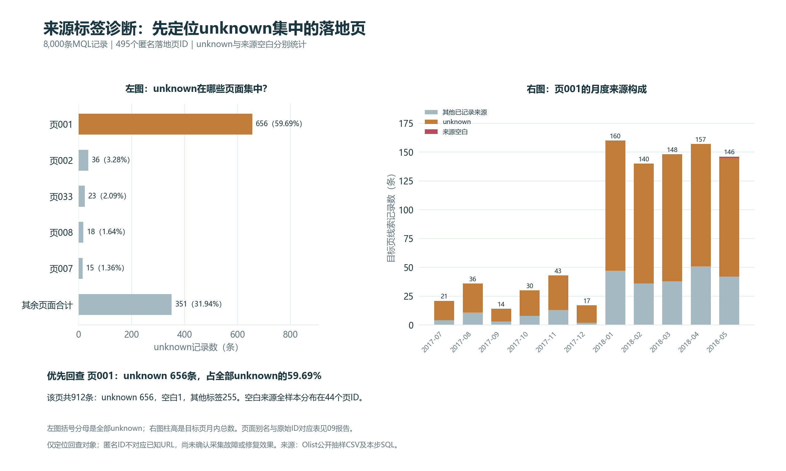

# 第九步：来源标签与落地页诊断

## 核心发现

共8,000条线索、495个匿名落地页ID。unknown有1,099条，来源空白60条，两类分别分析。

按unknown记录数排序，优先回查页001（原始ID：`b76ef37428e6799c421989521c0e5077`）。它有656条unknown，占全部unknown的59.69%；这表示问题线索集中位置，不代表已确认故障。

该页共912条线索，unknown 656条、空白1条、其他已记录来源255条。页内unknown占比71.93%；unknown与空白合计占比72.04%。不要混淆以上不同分母。

## unknown与空白的集中程度

| 标签类别 | 记录数 | 涉及页ID数 | Top1占该类 | Top3占该类 | Top5占该类 | Top10占该类 |
| --- | ---: | ---: | ---: | ---: | ---: | ---: |
| unknown | 1099 | 186 | 59.69% | 65.06% | 68.06% | 72.98% |
| 来源空白 | 60 | 44 | 8.33% | 21.67% | 31.67% | 43.33% |

两类的页面分布不同，不能自动认定为同一根因。没有按签约表现挑选目标页，也没有把小分母高比例页面排成效果赢家。

## 目标页按首次联系月份拆分

| 月份 | 线索数 | unknown | 空白 | 其他已记录来源 | 页内unknown占比 |
| --- | ---: | ---: | ---: | ---: | ---: |
| 2017-07 | 21 | 17 | 0 | 4 | 80.95% |
| 2017-08 | 36 | 25 | 0 | 11 | 69.44% |
| 2017-09 | 14 | 11 | 0 | 3 | 78.57% |
| 2017-10 | 30 | 22 | 0 | 8 | 73.33% |
| 2017-11 | 43 | 30 | 0 | 13 | 69.77% |
| 2017-12 | 17 | 15 | 0 | 2 | 88.24% |
| 2018-01 | 160 | 113 | 0 | 47 | 70.63% |
| 2018-02 | 140 | 104 | 0 | 36 | 74.29% |
| 2018-03 | 148 | 110 | 0 | 38 | 74.32% |
| 2018-04 | 157 | 106 | 0 | 51 | 67.52% |
| 2018-05 | 146 | 103 | 1 | 42 | 70.55% |

只展示目标页有线索的月份；没有线索的月份不补0%比例。unknown数量变化要结合月内总量与占比，不能把计数增加直接归因为采集故障加重。

## 建议怎样回查

1. 若能取得企业后台，先把此匿名ID映射到真实落地页与表单配置；当前公开数据不包含URL或页面内容。
2. 核对来源标签字典、来源采集／映射规则及历史配置变化，同时分别回查unknown与空白。
3. 补齐原始访问及表单日志后抽样核验，再判断是否属于未分类来源、规则差异或采集问题。

以上是待执行的核查建议，没有证明故障根因、实施修复或测得修复收益。该页ID也不等于已经验证的独立页面版本或独立商家。

## 图表



## 页面别名与完整汇总

页面别名按全部线索量从大到小分配，数量相同时按原始ID排序；下面按unknown数量排序。保留所有页面，不删除小样本。

| 别名 | 原始匿名ID | 线索数 | unknown | 空白 | 其他标签 | 页内unknown占比 |
| --- | --- | ---: | ---: | ---: | ---: | ---: |
| 页001 | b76ef37428e6799c421989521c0e5077 | 912 | 656 | 1 | 255 | 71.93% |
| 页002 | 22c29808c4f815213303f8933030604c | 883 | 36 | 5 | 842 | 4.08% |
| 页033 | c555aa36478386fdf85a2d0ca5cd0ff8 | 37 | 23 | 0 | 14 | 62.16% |
| 页008 | e492ee5eaf1697716985cc6f33f9cd9b | 291 | 18 | 0 | 273 | 6.19% |
| 页007 | f017be4dbf86243af5c1ebed0cff36a2 | 310 | 15 | 0 | 295 | 4.84% |
| 页005 | ce1a65abd0973638f1c887a6efcfa82d | 394 | 14 | 0 | 380 | 3.55% |
| 页014 | 1722481ac9e5371e5099dea226b5421d | 86 | 13 | 1 | 72 | 15.12% |
| 页045 | 27cd3540bace1f4a4b2bc6d319b0553c | 25 | 11 | 0 | 14 | 44.00% |
| 页115 | 154e7506c0176dc761f19fa0cb4988c4 | 9 | 8 | 0 | 1 | 88.89% |
| 页028 | 21a104c3279681d9856b8a48723c4fee | 47 | 8 | 1 | 38 | 17.02% |
| 页022 | 36120633c8737035fbabf079082f4ec1 | 59 | 7 | 0 | 52 | 11.86% |
| 页006 | 40dec9f3d5259a3d2dbcdab2114fae47 | 330 | 7 | 0 | 323 | 2.12% |
| 页004 | 88740e65d5d6b056e0cda098e1ea6313 | 445 | 7 | 0 | 438 | 1.57% |
| 页063 | 6a110e795dd487f1cf8d7583671987af | 20 | 6 | 0 | 14 | 30.00% |
| 页042 | da14b7e2eb0d1eecf65abbd05a31c87d | 29 | 6 | 1 | 22 | 20.69% |
| 页056 | 0e5a178e3cd2368607f3e72f46140476 | 21 | 5 | 0 | 16 | 23.81% |
| 页062 | 358adb2fee9a122549618e46925a00a5 | 20 | 5 | 0 | 15 | 25.00% |
| 页012 | 65d9f9d71e562365e8b44037c2888d98 | 95 | 5 | 0 | 90 | 5.26% |
| 页010 | 73f31a40697cc90a86c1273563ac230e | 115 | 5 | 0 | 110 | 4.35% |
| 页009 | a7982125ff7aa3b2054c6e44f9d28522 | 156 | 5 | 1 | 150 | 3.21% |
| 页148 | aa8af3ebe14831a7cd1b6d1383a03755 | 6 | 5 | 0 | 1 | 83.33% |
| 页060 | ee3c3bad6ed3eb9d5de56688d1f9c91b | 21 | 5 | 0 | 16 | 23.81% |
| 页026 | 0218f6be0b76aca72ab4d00ee9e8cf10 | 48 | 4 | 0 | 44 | 8.33% |
| 页015 | 1ceb590cd1e00c7ee95220971f82693d | 71 | 4 | 1 | 66 | 5.63% |
| 页019 | 330b9d44078a1ae5a221d655dcb77afa | 63 | 4 | 1 | 58 | 6.35% |
| 页066 | 3b86d7e8c33da2767ad2af9782f383d5 | 18 | 4 | 0 | 14 | 22.22% |
| 页003 | 58326e62183c14b0c03085c33b9fdc44 | 495 | 4 | 3 | 488 | 0.81% |
| 页052 | 58f8c0a253663304e348e81298bc255e | 22 | 4 | 0 | 18 | 18.18% |
| 页025 | f80696b73d17fb34f5c4fde157f119d8 | 49 | 4 | 1 | 44 | 8.16% |
| 页023 | f98c2bd96ac4a5d9476734e790c91384 | 58 | 4 | 1 | 53 | 6.90% |
| 页061 | 2228a43ac0bc372e25f9569e69fc9015 | 20 | 3 | 0 | 17 | 15.00% |
| 页029 | 3cd2a8301d5395f21cdd3094c9eaa2f4 | 42 | 3 | 1 | 38 | 7.14% |
| 页173 | 5679ae2329cbad78cdf97737d11bad06 | 4 | 3 | 0 | 1 | 75.00% |
| 页013 | 87732658ba41d8775e8577df347a64db | 92 | 3 | 0 | 89 | 3.26% |
| 页050 | 909e333f8f23574f93115bd3d402e202 | 23 | 3 | 0 | 20 | 13.04% |
| 页075 | 91dbdf987124ca09b297bd87f06b5e64 | 16 | 3 | 0 | 13 | 18.75% |
| 页035 | a0fbc0263cb98bdb0d72b9f9f283a172 | 36 | 3 | 0 | 33 | 8.33% |
| 页038 | bddebc4f4d44106c427bd00695840e64 | 32 | 3 | 0 | 29 | 9.38% |
| 页089 | c05f0fd41e79d7811221253e0d4eadc8 | 13 | 3 | 0 | 10 | 23.08% |
| 页036 | d83b0d0e48c8447d1d5507a44027a955 | 34 | 3 | 0 | 31 | 8.82% |
| 页043 | e42a14209c69c3e9cc6b042620465f12 | 29 | 3 | 0 | 26 | 10.34% |
| 页071 | e92a6f37ebb87a6bfbc569d439cf1635 | 17 | 3 | 0 | 14 | 17.65% |
| 页027 | 30077c17f2ec5010a82e37ad8925b95f | 48 | 2 | 1 | 45 | 4.17% |
| 页190 | 37145c5650a33da9e6b2df70ae1aec80 | 3 | 2 | 0 | 1 | 66.67% |
| 页086 | 37cf94070e940a694969304de58debe1 | 13 | 2 | 0 | 11 | 15.38% |
| 页037 | 4aab772aeb9833c170d8ea5413e02eac | 32 | 2 | 0 | 30 | 6.25% |
| 页040 | 4e82dd1f6d00626bda0723eef0a269a6 | 30 | 2 | 0 | 28 | 6.67% |
| 页087 | 82ce7345d29d3003d376f9382fc0eba0 | 13 | 2 | 0 | 11 | 15.38% |
| 页121 | 87e8cbe800fd79c7109fb24081c1c31d | 9 | 2 | 0 | 7 | 22.22% |
| 页078 | 8ff57dffc365fcb5233232fff6e6bfd0 | 15 | 2 | 0 | 13 | 13.33% |
| 页076 | 966098efaef7a4d665be6b0cb617541b | 16 | 2 | 1 | 13 | 12.50% |
| 页017 | b6885f18d203a61176418c1fb3764815 | 67 | 2 | 0 | 65 | 2.99% |
| 页209 | c0fb5b3c854a4b30334892c71faa13c2 | 3 | 2 | 0 | 1 | 66.67% |
| 页065 | c70eb6fb5bd6e939b0d5ef32f21f61e8 | 19 | 2 | 1 | 16 | 10.53% |
| 页047 | daa9619c6f8ed06d059265dca0f9257f | 25 | 2 | 0 | 23 | 8.00% |
| 页064 | dfc3b656bac13de62e4efca322b3f2c1 | 20 | 2 | 0 | 18 | 10.00% |
| 页246 | e2e67cce16ad4e30e1f8962402480f17 | 2 | 2 | 0 | 0 | 100.00% |
| 页072 | ea0650174e273c41e12002dcdd4708be | 17 | 2 | 0 | 15 | 11.76% |
| 页093 | f03e241af08912ba7ffb65d69b0eb4d9 | 12 | 2 | 0 | 10 | 16.67% |
| 页018 | 007f9098284a86ee80ddeb25d53e0af8 | 66 | 1 | 0 | 65 | 1.52% |
| 页249 | 01850876d34b43494b5f9879c366877b | 1 | 1 | 0 | 0 | 100.00% |
| 页251 | 04a75b75d5f4f3a16b0178fbe382da00 | 1 | 1 | 0 | 0 | 100.00% |
| 页253 | 099ddda4feb08e89c402f2d38ca94b2e | 1 | 1 | 0 | 0 | 100.00% |
| 页254 | 0a252e869424c89cf3608e07399b61f6 | 1 | 1 | 0 | 0 | 100.00% |
| 页113 | 0b9430edcbf2d9a95148c806af2b6699 | 9 | 1 | 0 | 8 | 11.11% |
| 页256 | 0d5837d82188e547040314b5db344a0c | 1 | 1 | 0 | 0 | 100.00% |
| 页095 | 111313f5b9ceedf17ab5af7317a9f9bc | 11 | 1 | 0 | 10 | 9.09% |
| 页096 | 128d8c3f32b8aa66b5bcbe4e26dfc78d | 11 | 1 | 0 | 10 | 9.09% |
| 页258 | 13fa6688e41e863dcbfdb4c6112c4c86 | 1 | 1 | 0 | 0 | 100.00% |
| 页260 | 146e076b71a6ca8c31b34191182a313a | 1 | 1 | 0 | 0 | 100.00% |
| 页261 | 149878f8f96bf77a1a69f88519a8fe99 | 1 | 1 | 0 | 0 | 100.00% |
| 页262 | 151d5575a642287261af4311d569e07c | 1 | 1 | 0 | 0 | 100.00% |
| 页030 | 15cf89bab2c3163b4f9d8601d108f8b2 | 41 | 1 | 0 | 40 | 2.44% |
| 页263 | 166fa7410ac1923b2cf2680f79e08850 | 1 | 1 | 0 | 0 | 100.00% |
| 页264 | 19f7d64c187f64e4c089786e84510ff2 | 1 | 1 | 0 | 0 | 100.00% |
| 页169 | 1e884e3078d9978e216a027ecd57fb34 | 4 | 1 | 2 | 1 | 25.00% |
| 页270 | 20267f479a91ac26c09f83ae13adfa1e | 1 | 1 | 0 | 0 | 100.00% |
| 页271 | 21aa3161ecfcb855e82c0ef1ebdf410d | 1 | 1 | 0 | 0 | 100.00% |
| 页272 | 2204d1cf0ec6a0cf20f7342e99d88ec8 | 1 | 1 | 0 | 0 | 100.00% |
| 页189 | 22218292bcb562cf33f2342d57952479 | 3 | 1 | 0 | 2 | 33.33% |
| 页011 | 241f79c7a8fe0270f4fb79fcbbcd17ad | 109 | 1 | 0 | 108 | 0.92% |
| 页279 | 2cae266d756f8688d24bf43c5b5d9d84 | 1 | 1 | 0 | 0 | 100.00% |
| 页281 | 2feec85dc487b235304e69f08fed3a39 | 1 | 1 | 0 | 0 | 100.00% |
| 页282 | 30c86954adc2eec0f2589a8bfc4c573f | 1 | 1 | 0 | 0 | 100.00% |
| 页283 | 320669df6e03fc8a691a1a4c61c56a32 | 1 | 1 | 0 | 0 | 100.00% |
| 页288 | 33751088e4687d1b6b2424b9e5e67979 | 1 | 1 | 0 | 0 | 100.00% |
| 页218 | 33d93d27f43d86b4a7e89186936d8c6c | 2 | 1 | 0 | 1 | 50.00% |
| 页021 | 35c9b150ab36fe584c1f24fd458c453a | 59 | 1 | 0 | 58 | 1.69% |
| 页289 | 36137eeb4bf9b5f4054c5b83bef611fa | 1 | 1 | 0 | 0 | 100.00% |
| 页293 | 375e354da26e8619e407002dde41f19c | 1 | 1 | 0 | 0 | 100.00% |
| 页299 | 3b9715bd3b57ba1727acec71ed308568 | 1 | 1 | 0 | 0 | 100.00% |
| 页301 | 3c46fdd071e979b10c7a2ccc395e72f0 | 1 | 1 | 0 | 0 | 100.00% |
| 页157 | 3c5cc1a2e1d86abfce2a16a1bcc80e26 | 5 | 1 | 0 | 4 | 20.00% |
| 页302 | 3cc38c43666a7f2faedf74d0d718ba94 | 1 | 1 | 0 | 0 | 100.00% |
| 页304 | 3e3371f8470ce094c7c82c09b7bd59d9 | 1 | 1 | 0 | 0 | 100.00% |
| 页305 | 3f3196b43b4af9aafbe878f6a1bbc7bd | 1 | 1 | 0 | 0 | 100.00% |
| 页221 | 425a9f1cd945cb291c58c4212654eb8d | 2 | 1 | 0 | 1 | 50.00% |
| 页193 | 431a558885d03bf98bc3747f78cdfab7 | 3 | 1 | 0 | 2 | 33.33% |
| 页135 | 4513838e626b499f475f9b488d177c55 | 7 | 1 | 0 | 6 | 14.29% |
| 页308 | 47a9f630d492167d7390ff23cf40dab6 | 1 | 1 | 0 | 0 | 100.00% |
| 页311 | 4c4b6da00763e942beb82e36b58d4118 | 1 | 1 | 0 | 0 | 100.00% |
| 页314 | 4e33f301b88ec7f40f82be48344f7a4e | 1 | 1 | 0 | 0 | 100.00% |
| 页144 | 51ecca024748b4439e473ec446c0bef5 | 6 | 1 | 0 | 5 | 16.67% |
| 页318 | 52a08c56d3b13cb6c8ce804776423e6b | 1 | 1 | 0 | 0 | 100.00% |
| 页322 | 557cc18ae3b10b7fd35fbed2019910b1 | 1 | 1 | 0 | 0 | 100.00% |
| 页117 | 57d5edb1844a746128fd1274524b94c7 | 9 | 1 | 0 | 8 | 11.11% |
| 页325 | 5870b76c7b4ff735e08214a63fdbbecf | 1 | 1 | 0 | 0 | 100.00% |
| 页326 | 58c77ebccfe901ecb02789124bee6608 | 1 | 1 | 0 | 0 | 100.00% |
| 页224 | 5bc6da5f353093c37734eddd2eafc993 | 2 | 1 | 0 | 1 | 50.00% |
| 页145 | 5c6c41289f4d77b9b32fb6a5e2106edb | 6 | 1 | 0 | 5 | 16.67% |
| 页031 | 5dc848e7dd9418dffe183215b8ff0bc1 | 41 | 1 | 1 | 39 | 2.44% |
| 页336 | 60877a8e7a44a3ad9fe1af9359efa0dd | 1 | 1 | 0 | 0 | 100.00% |
| 页159 | 6323b8a5b98bfda127cb1cdfd4a40fbb | 5 | 1 | 0 | 4 | 20.00% |
| 页337 | 638d98a3871a7670e644fa1b69111fab | 1 | 1 | 0 | 0 | 100.00% |
| 页341 | 66f0eb34b1d43f33779493fc31c5d131 | 1 | 1 | 0 | 0 | 100.00% |
| 页342 | 67215f7bc6c2a85df0711d66d514a3d9 | 1 | 1 | 0 | 0 | 100.00% |
| 页343 | 6744140b06a752fafd3c7e4937075ca8 | 1 | 1 | 0 | 0 | 100.00% |
| 页345 | 67f163b6f2baf0f12300d9efa4589e79 | 1 | 1 | 0 | 0 | 100.00% |
| 页346 | 682c403426855d4a7612ff724efb404a | 1 | 1 | 0 | 0 | 100.00% |
| 页347 | 686e82dd914f82d16ef05415f4419d4f | 1 | 1 | 0 | 0 | 100.00% |
| 页352 | 6be62e2d792dfec1333ce271c9a1d906 | 1 | 1 | 0 | 0 | 100.00% |
| 页355 | 6eb30e742d5ee0762fd726e9690c2a1a | 1 | 1 | 0 | 0 | 100.00% |
| 页083 | 733adfe409c752b5c200bf23fa2f22d0 | 14 | 1 | 0 | 13 | 7.14% |
| 页361 | 758daa2c01d04b06f42a8aa819ad8d46 | 1 | 1 | 0 | 0 | 100.00% |
| 页365 | 7cae0e79bdcf71dfd512f1100219fdbc | 1 | 1 | 0 | 0 | 100.00% |
| 页102 | 7eb40e4e44fef8bff604b621119446c7 | 11 | 1 | 0 | 10 | 9.09% |
| 页016 | 7fa6214d82e911d070f51ef79381b956 | 68 | 1 | 1 | 66 | 1.47% |
| 页368 | 7fdee983c737fb9d29dbd5c094136a97 | 1 | 1 | 0 | 0 | 100.00% |
| 页230 | 80d35379df4ce2f5297acefc78f60907 | 2 | 1 | 1 | 0 | 50.00% |
| 页370 | 82bfb9f61deccae8b25c32c318b99f56 | 1 | 1 | 0 | 0 | 100.00% |
| 页372 | 83355a82a9cee26f3ba2b186ddb0bbbe | 1 | 1 | 0 | 0 | 100.00% |
| 页074 | 87780f7c05ecd79791bde76af663db15 | 16 | 1 | 0 | 15 | 6.25% |
| 页147 | 8d25d9ae4ed5f78b8614b81350173e99 | 6 | 1 | 0 | 5 | 16.67% |
| 页380 | 8dcb4a581ceca6be2399a15de4d39048 | 1 | 1 | 0 | 0 | 100.00% |
| 页382 | 8e1f60cfb4a7def895d8baf0eec1394e | 1 | 1 | 0 | 0 | 100.00% |
| 页383 | 8e3b5d566a45e76ba85c3a2e34428668 | 1 | 1 | 0 | 0 | 100.00% |
| 页202 | 8f08d2ef8b9aec2ec5118fbcf7f96f11 | 3 | 1 | 0 | 2 | 33.33% |
| 页389 | 94472cf01c2c1ec24e24f5b0f9ca24a3 | 1 | 1 | 0 | 0 | 100.00% |
| 页390 | 9496ccbb759ca86ff2b76adb4f7672a6 | 1 | 1 | 0 | 0 | 100.00% |
| 页122 | 97338d2165e7d6d9bc1348573a405642 | 9 | 1 | 0 | 8 | 11.11% |
| 页393 | 97f34946d127e73fb33c3d86ecca344c | 1 | 1 | 0 | 0 | 100.00% |
| 页394 | 984c5278c0a8e3c75e41b90def1f2611 | 1 | 1 | 0 | 0 | 100.00% |
| 页395 | 984caf5cd6531beb94e435db458b7cc9 | 1 | 1 | 0 | 0 | 100.00% |
| 页397 | 9a26036e9f038f248693cb8a5a1f1ddc | 1 | 1 | 0 | 0 | 100.00% |
| 页400 | 9c19bf493fb017f18387b466e26d6c5d | 1 | 1 | 0 | 0 | 100.00% |
| 页406 | a3c42430cd0c931fc07c918979d8baeb | 1 | 1 | 0 | 0 | 100.00% |
| 页408 | a41b8b7318c4f42dbb65c277861ca89d | 1 | 1 | 0 | 0 | 100.00% |
| 页409 | a5155c8274e4b6d13fe0db420a60a287 | 1 | 1 | 0 | 0 | 100.00% |
| 页046 | a56671a54260a44923d32c2f08fad39c | 25 | 1 | 0 | 24 | 4.00% |
| 页123 | a5f7caba65f90d45005f62cb85bced39 | 9 | 1 | 0 | 8 | 11.11% |
| 页205 | a6ad0162dbe1182cd73e783d0ec1ffcf | 3 | 1 | 0 | 2 | 33.33% |
| 页418 | b221554b9ec12f7efb490488a053e8dc | 1 | 1 | 0 | 0 | 100.00% |
| 页421 | b34c567bf9cfa6ddc40b5b0d2d9c5bc7 | 1 | 1 | 0 | 0 | 100.00% |
| 页237 | b52be9379d67e7fbf3734111625cc017 | 2 | 1 | 0 | 1 | 50.00% |
| 页427 | b634a925e3768734c5b7b2325c88a082 | 1 | 1 | 0 | 0 | 100.00% |
| 页180 | b817df3a69949ef27ed885bfcbfd5125 | 4 | 1 | 0 | 3 | 25.00% |
| 页428 | b91e936ef19215572bb05977faae1d85 | 1 | 1 | 0 | 0 | 100.00% |
| 页059 | bdaeb752e5c3caa215ebe04c61e22325 | 21 | 1 | 0 | 20 | 4.76% |
| 页088 | bfd05fa9f9fe2aedee539951a84f2aaf | 13 | 1 | 0 | 12 | 7.69% |
| 页239 | c12c73f22a34ac35f2c45f74b55402b0 | 2 | 1 | 0 | 1 | 50.00% |
| 页432 | c2826f1fb1ca7c1b7c7b63c1018b8ba5 | 1 | 1 | 0 | 0 | 100.00% |
| 页092 | c6f28f804cf6330e6de735ef6e6fe95c | 12 | 1 | 1 | 10 | 8.33% |
| 页440 | cb15e297b291d8ef88f2f477defaab2d | 1 | 1 | 0 | 0 | 100.00% |
| 页441 | cc99b45713ce89a0a569e36be200e8ca | 1 | 1 | 0 | 0 | 100.00% |
| 页446 | d1da19204d3ed40c6476ad7498fb3e8b | 1 | 1 | 0 | 0 | 100.00% |
| 页447 | d27094ded8d5242d4d2ba9d7e5f176b4 | 1 | 1 | 0 | 0 | 100.00% |
| 页151 | d28554990d8c5273fedfde51f1f8a59d | 6 | 1 | 0 | 5 | 16.67% |
| 页448 | d387e61aff60919eae0a5ef1773db0db | 1 | 1 | 0 | 0 | 100.00% |
| 页039 | d45d558f0daeecf3cccdffe3c59684aa | 32 | 1 | 0 | 31 | 3.13% |
| 页449 | d498d8fea0c0458bf3553775a60e66ec | 1 | 1 | 0 | 0 | 100.00% |
| 页130 | d7549bc9744c53d31a4a1abc7fb7b5ee | 8 | 1 | 0 | 7 | 12.50% |
| 页456 | dabf7461e7b9fbcb03eb28449632f0c6 | 1 | 1 | 0 | 0 | 100.00% |
| 页460 | de49b5a73de3b19b3339700fe733886c | 1 | 1 | 0 | 0 | 100.00% |
| 页464 | dff49c1e54630a22f1ca28fcc02daca0 | 1 | 1 | 0 | 0 | 100.00% |
| 页466 | e30b6fe36d1ad2145ca4544e3362b5c1 | 1 | 1 | 0 | 0 | 100.00% |
| 页054 | e534a08b23c682d94859d0ab860bd57a | 22 | 1 | 1 | 20 | 4.55% |
| 页473 | e998c9a2c0e92504311cde9e43a34026 | 1 | 1 | 0 | 0 | 100.00% |
| 页474 | e9e396caabf546e0ff4f747b47538192 | 1 | 1 | 0 | 0 | 100.00% |
| 页480 | eddb68be86556f76236ecf815d32facb | 1 | 1 | 0 | 0 | 100.00% |
| 页481 | ee40ded7dc801923f81ab6dbbf6e5417 | 1 | 1 | 0 | 0 | 100.00% |
| 页131 | ef8fd2bd651e9bede81dfb6e45480793 | 8 | 1 | 0 | 7 | 12.50% |
| 页487 | f55ba1da3448d20e213b0a10385eac07 | 1 | 1 | 0 | 0 | 100.00% |
| 页183 | fa6f59a21825d841e307151460fb0302 | 4 | 1 | 0 | 3 | 25.00% |
| 页055 | fb58285f6f6c4e504dfa628de116cae8 | 22 | 1 | 0 | 21 | 4.55% |
| 页492 | fc83c311415c9f67b6c7c87cf488b9c2 | 1 | 1 | 0 | 0 | 100.00% |
| 页132 | fe82aeadeaea2186478fe6353d6d5301 | 8 | 1 | 0 | 7 | 12.50% |
| 页250 | 03c7c0ace395d80182db07ae2c30f034 | 1 | 0 | 0 | 1 | 0.00% |
| 页184 | 061c3918f72d289ee93d5d8a06c15c2e | 3 | 0 | 0 | 3 | 0.00% |
| 页185 | 0625ca637bf063abf254a66fe91fa84b | 3 | 0 | 0 | 3 | 0.00% |
| 页252 | 081b0e629b3899db213a23bc4e58a17d | 1 | 0 | 0 | 1 | 0.00% |
| 页212 | 08940bbad6e96fc4e620f2d9a00b1db4 | 2 | 0 | 0 | 2 | 0.00% |
| 页186 | 090ffa1062e6dde353c36524563acefc | 3 | 0 | 0 | 3 | 0.00% |
| 页153 | 09949e05e2c5fa4ba780fe27213bc575 | 5 | 0 | 0 | 5 | 0.00% |
| 页255 | 0a946f83fbafa9ebf3d1c1083a6d865b | 1 | 0 | 0 | 1 | 0.00% |
| 页133 | 0b353d6bc27566f1d238313c33d95f56 | 7 | 0 | 0 | 7 | 0.00% |
| 页044 | 0b37d43dbde6452cdd94c17bf61a88e4 | 27 | 0 | 0 | 27 | 0.00% |
| 页167 | 0c83f57c786a0b4a39efab23731c7ebc | 4 | 0 | 4 | 0 | 0.00% |
| 页168 | 0d43fc5a5096c416d3b7b492564293da | 4 | 0 | 0 | 4 | 0.00% |
| 页187 | 0d6bc3c00e4e64927cae2e8d9c6a0b9b | 3 | 0 | 0 | 3 | 0.00% |
| 页257 | 0edc241702f5e6c046cbdbc4b5ef6a13 | 1 | 0 | 0 | 1 | 0.00% |
| 页085 | 0f25be78376bbbaba8553051e980b83c | 13 | 0 | 0 | 13 | 0.00% |
| 页114 | 0f7f8ed9a1db8fc2a42e273972db10d4 | 9 | 0 | 0 | 9 | 0.00% |
| 页213 | 10f5ac17ed7d6ee9a7d737ac1d2fcb32 | 2 | 0 | 0 | 2 | 0.00% |
| 页081 | 120ad10683075526ee1b3b00489dafec | 14 | 0 | 0 | 14 | 0.00% |
| 页259 | 142187f4dbc5f5dc401d35e896ad29f1 | 1 | 0 | 0 | 1 | 0.00% |
| 页091 | 1694e838dffa97f640fcfa35e86e438e | 12 | 0 | 0 | 12 | 0.00% |
| 页214 | 16d718d40146b50ca7a8a045f1b06834 | 2 | 0 | 0 | 2 | 0.00% |
| 页215 | 1754aa3138d36ccc989ffa4362719181 | 2 | 0 | 0 | 2 | 0.00% |
| 页140 | 186132bda8b5f41c7dc834d063745d19 | 6 | 0 | 0 | 6 | 0.00% |
| 页265 | 1b29d3a0b89bc8da6df20e98dfac86f4 | 1 | 0 | 0 | 1 | 0.00% |
| 页097 | 1baca9df5850e5ba75545d8b2eb8d966 | 11 | 0 | 0 | 11 | 0.00% |
| 页266 | 1c19071a49fd2b43d0d4df3ff05c19c4 | 1 | 0 | 0 | 1 | 0.00% |
| 页267 | 1d298480a2f10b8c7527eeb6fcf1df97 | 1 | 0 | 0 | 1 | 0.00% |
| 页098 | 1d4ddc25ccaa2adeded340b6eda66182 | 11 | 0 | 0 | 11 | 0.00% |
| 页268 | 1d83f02bfc05b6715ef428ee0ccd78be | 1 | 0 | 0 | 1 | 0.00% |
| 页154 | 1ec5f5ec77c51a968271b2ca9862907d | 5 | 0 | 1 | 4 | 0.00% |
| 页269 | 1ee8e9027201b4aead6b5c6fa7846eee | 1 | 0 | 0 | 1 | 0.00% |
| 页188 | 1f2ef44bd62ca960c9391166cae6fd3c | 3 | 0 | 0 | 3 | 0.00% |
| 页134 | 214b0943d4ad794c4086cf7e38785ef2 | 7 | 0 | 0 | 7 | 0.00% |
| 页273 | 245b65531b938a173db059ad8f034482 | 1 | 0 | 0 | 1 | 0.00% |
| 页274 | 24d866dcbe66afe0feee5936c5d54cac | 1 | 0 | 0 | 1 | 0.00% |
| 页155 | 253c51690efe34b79a8e2b516effa8cc | 5 | 0 | 0 | 5 | 0.00% |
| 页275 | 2635743d5842a4475730345cf894efce | 1 | 0 | 1 | 0 | 0.00% |
| 页276 | 270c9837c3b21fb83bee9224f701f3aa | 1 | 0 | 0 | 1 | 0.00% |
| 页277 | 282cb66cf00adbf96a4486eb4cb2431c | 1 | 0 | 0 | 1 | 0.00% |
| 页278 | 294ce16d2b3c2186a805f26aa8de3ebc | 1 | 0 | 0 | 1 | 0.00% |
| 页099 | 298895230612f85f0742434fc434ad10 | 11 | 0 | 0 | 11 | 0.00% |
| 页216 | 2b3ba77df5d7657e8c515a1c74155b99 | 2 | 0 | 0 | 2 | 0.00% |
| 页280 | 2e84ebc35438eb47630f2fae4218c9c7 | 1 | 0 | 0 | 1 | 0.00% |
| 页057 | 2f08471dfb83baef522f952438a36f6e | 21 | 0 | 0 | 21 | 0.00% |
| 页032 | 30534107aa0013db92899c96a1017d0b | 37 | 0 | 0 | 37 | 0.00% |
| 页116 | 313edefdee4adcd34e8cbec1854ba5a9 | 9 | 0 | 0 | 9 | 0.00% |
| 页217 | 31aa231b755f09653f48e41c110c8860 | 2 | 0 | 0 | 2 | 0.00% |
| 页284 | 3207d4688de4e0e721272756dd4339b8 | 1 | 0 | 0 | 1 | 0.00% |
| 页285 | 3251617f7f52477cfa4689dae4c10322 | 1 | 0 | 0 | 1 | 0.00% |
| 页286 | 32d0cd3623c4eab3ededbe84943049d2 | 1 | 0 | 0 | 1 | 0.00% |
| 页170 | 33009ff58323b15ce24eba767675f434 | 4 | 0 | 0 | 4 | 0.00% |
| 页287 | 336d5ebc5436534e61d16e63ddfca327 | 1 | 0 | 0 | 1 | 0.00% |
| 页171 | 346137f3e0157d94372d1cafc5675908 | 4 | 0 | 0 | 4 | 0.00% |
| 页219 | 34c9ef8fb69f256ff66add711305d279 | 2 | 0 | 0 | 2 | 0.00% |
| 页156 | 36525851387908b96e770b1ce5d79a43 | 5 | 0 | 0 | 5 | 0.00% |
| 页290 | 3683ba5726e741af4b8b02bcaef4e7b3 | 1 | 0 | 0 | 1 | 0.00% |
| 页291 | 36b6e21a46b7b35a459bed735785772a | 1 | 0 | 0 | 1 | 0.00% |
| 页292 | 3757ed31bc4b61f9e108bd871822c0c6 | 1 | 0 | 0 | 1 | 0.00% |
| 页294 | 382c8bbbcb0aab881c1a340d390b5e32 | 1 | 0 | 0 | 1 | 0.00% |
| 页295 | 386ab4223b463542f214d97a27247329 | 1 | 0 | 0 | 1 | 0.00% |
| 页296 | 38addfd5b0598e69bfa843b9c85c9a19 | 1 | 0 | 0 | 1 | 0.00% |
| 页297 | 3a21003b9294a4eec831bac080494843 | 1 | 0 | 0 | 1 | 0.00% |
| 页298 | 3aea860a87895eee6b72f666b3d7b98a | 1 | 0 | 1 | 0 | 0.00% |
| 页300 | 3c3d58faafc86beae6e757f1470ce9f0 | 1 | 0 | 0 | 1 | 0.00% |
| 页303 | 3d75f6dd34b968151b3e86c9e28f1379 | 1 | 0 | 1 | 0 | 0.00% |
| 页191 | 3e2dbc66617ded5ca6a69bdb3a354d4a | 3 | 0 | 0 | 3 | 0.00% |
| 页192 | 3fd71e7e6cf64921740567dcfefb68cf | 3 | 0 | 0 | 3 | 0.00% |
| 页220 | 40acf2a9cf2fe4de391609431f40dfb7 | 2 | 0 | 0 | 2 | 0.00% |
| 页141 | 42a2a1be58277f162c18bad69bcc544f | 6 | 0 | 0 | 6 | 0.00% |
| 页194 | 447cabeecc99dc245cb42be7122cba9e | 3 | 0 | 0 | 3 | 0.00% |
| 页306 | 44cb5e9f50dfa3b36e485b0f26c4fe5f | 1 | 0 | 0 | 1 | 0.00% |
| 页307 | 46bbd1ad032b44f18f1fb613200965a0 | 1 | 0 | 0 | 1 | 0.00% |
| 页142 | 46bd119220c8bf61324669b1d82203ac | 6 | 0 | 0 | 6 | 0.00% |
| 页309 | 47eeb9ed8fa40de028e33449896579a1 | 1 | 0 | 0 | 1 | 0.00% |
| 页172 | 489a340e7e59e0bcbec67b4a19c1b229 | 4 | 0 | 0 | 4 | 0.00% |
| 页310 | 4a295a87a340012cd5cb23cbb5e7461b | 1 | 0 | 0 | 1 | 0.00% |
| 页143 | 4b0974ddecd83fd34439a7312a609824 | 6 | 0 | 0 | 6 | 0.00% |
| 页312 | 4c683c64df361d9d0ca0257aa0d80f49 | 1 | 0 | 0 | 1 | 0.00% |
| 页313 | 4e24f6443807ad2eba56754b0dc91140 | 1 | 0 | 0 | 1 | 0.00% |
| 页195 | 4ed6bf4ac34e75c7c81fcf829d96b739 | 3 | 0 | 0 | 3 | 0.00% |
| 页315 | 5071a8a3ad132bdea8de85e0c90effd1 | 1 | 0 | 0 | 1 | 0.00% |
| 页222 | 50f87b85a731cec08d8380b08c573ed3 | 2 | 0 | 0 | 2 | 0.00% |
| 页316 | 515742ea988a44a8ca0ddc44ff92735f | 1 | 0 | 0 | 1 | 0.00% |
| 页073 | 5209e2e679d32a6619feb6942702fd14 | 16 | 0 | 0 | 16 | 0.00% |
| 页317 | 5215a2f4c4cb554cb18c8de3b4f06df5 | 1 | 0 | 0 | 1 | 0.00% |
| 页319 | 5325ad032ef3e3d5e7dc9e1ec565fa23 | 1 | 0 | 0 | 1 | 0.00% |
| 页320 | 5342a9e3497ac934ce6a4e62086cfcca | 1 | 0 | 0 | 1 | 0.00% |
| 页321 | 53afa44da0f77375f9ab54c9b8d61da8 | 1 | 0 | 0 | 1 | 0.00% |
| 页082 | 54d5e01ab35155d4bd8cf723fc6f04a0 | 14 | 0 | 0 | 14 | 0.00% |
| 页323 | 56be022a42b70a9b7e51755d3e3a4f22 | 1 | 0 | 0 | 1 | 0.00% |
| 页324 | 57c63d5cb72265135f694bb785d474c3 | 1 | 0 | 0 | 1 | 0.00% |
| 页327 | 5950e5dfc73454c6d83969bb09ba7fcd | 1 | 0 | 0 | 1 | 0.00% |
| 页328 | 5963a9ba5d6c9af62cba5a9ac76f263d | 1 | 0 | 0 | 1 | 0.00% |
| 页329 | 59d346b461701840a8ff44a94710704c | 1 | 0 | 0 | 1 | 0.00% |
| 页330 | 5b4fa71a2749f25fe9703a7987301c23 | 1 | 0 | 0 | 1 | 0.00% |
| 页223 | 5b893796c1ea6486bc0cc23a0a0fa11b | 2 | 0 | 0 | 2 | 0.00% |
| 页331 | 5c517d06e51b50ae51785450e0b806d5 | 1 | 0 | 0 | 1 | 0.00% |
| 页100 | 5ce25abc7206b8285aa756867eb2c590 | 11 | 0 | 0 | 11 | 0.00% |
| 页225 | 5d85e946cb22385b94eef98af7f76cb1 | 2 | 0 | 0 | 2 | 0.00% |
| 页069 | 5da54625ee0a9560dc9b9b9f6ccb03d0 | 17 | 0 | 0 | 17 | 0.00% |
| 页332 | 5e63931027e6805374c67e5988189028 | 1 | 0 | 0 | 1 | 0.00% |
| 页108 | 5ecb50153794666e90bc04c0076b7834 | 10 | 0 | 0 | 10 | 0.00% |
| 页196 | 5f8ff9510f85e3e9dcb1d74965bf8d48 | 3 | 0 | 0 | 3 | 0.00% |
| 页333 | 5fdaba20ee1cd0194652abb51479ddf9 | 1 | 0 | 0 | 1 | 0.00% |
| 页334 | 6018a468a00de93ac9bee91950c6a3d8 | 1 | 0 | 0 | 1 | 0.00% |
| 页335 | 603522877eb261ca56f4222c9a6f1db3 | 1 | 0 | 0 | 1 | 0.00% |
| 页197 | 607cb942712956d9e5cca504365378c0 | 3 | 0 | 0 | 3 | 0.00% |
| 页226 | 60ea0bbb4ee471b6b99e8b892847a8db | 2 | 0 | 0 | 2 | 0.00% |
| 页158 | 616767b0bfb0a97510747d8bbcc40290 | 5 | 0 | 0 | 5 | 0.00% |
| 页227 | 6265f632e27ca4d14268e0cb91ebc4a4 | 2 | 0 | 0 | 2 | 0.00% |
| 页174 | 62a620c9f1f5dbe99651c2c9e369cbb0 | 4 | 0 | 0 | 4 | 0.00% |
| 页126 | 63355b003224fe06badbd9de99644792 | 8 | 0 | 0 | 8 | 0.00% |
| 页338 | 639b8856a99f6e208406b764ba5a7be5 | 1 | 0 | 0 | 1 | 0.00% |
| 页228 | 63a22f10d1d63d25eaf970d6a9c9df2a | 2 | 0 | 0 | 2 | 0.00% |
| 页339 | 6404292b0f9a5594edf14be71ce4c221 | 1 | 0 | 1 | 0 | 0.00% |
| 页118 | 64078d75b35c1df83ebde92c7babe9d4 | 9 | 0 | 0 | 9 | 0.00% |
| 页198 | 645b2f3e4380afe5121a2a90ca732c74 | 3 | 0 | 0 | 3 | 0.00% |
| 页020 | 649b7b8b46b254497e92038d88f6ced8 | 62 | 0 | 0 | 62 | 0.00% |
| 页175 | 6511fd3ad2fc59d7f907bf22b13d19e3 | 4 | 0 | 0 | 4 | 0.00% |
| 页340 | 657e28a0f2bb6ac7755d08066847dae1 | 1 | 0 | 0 | 1 | 0.00% |
| 页119 | 65c9e96d17d8d12bc0ad3b2cde0bb8b7 | 9 | 0 | 0 | 9 | 0.00% |
| 页344 | 67e4b3ca7fb7e6e1e24767b1a6df70fe | 1 | 0 | 0 | 1 | 0.00% |
| 页101 | 68f817c510c978e3a3a7474ad2aeb75c | 11 | 0 | 0 | 11 | 0.00% |
| 页348 | 6a005efe7039a488ef82720efba1d28e | 1 | 0 | 0 | 1 | 0.00% |
| 页349 | 6a318eb72f69fe14f22c44abe23bdf53 | 1 | 0 | 0 | 1 | 0.00% |
| 页350 | 6b1061553497d45f6ac9d3386b648a4d | 1 | 0 | 0 | 1 | 0.00% |
| 页351 | 6b30a13289b856b66874b3838f177744 | 1 | 0 | 0 | 1 | 0.00% |
| 页229 | 6b6c0934205e87702519d1cce24055f9 | 2 | 0 | 2 | 0 | 0.00% |
| 页176 | 6d3026b7dff03974a1e250d610ab8b36 | 4 | 0 | 0 | 4 | 0.00% |
| 页353 | 6d45066876e395f8fe89add37704b90d | 1 | 0 | 0 | 1 | 0.00% |
| 页354 | 6dca9fc31d8a95cdbcfafcc307012768 | 1 | 0 | 1 | 0 | 0.00% |
| 页356 | 6ec28268c0772b612a9bc42881b8a313 | 1 | 0 | 0 | 1 | 0.00% |
| 页357 | 6ec35d2451cfa0e2e1c8595ec4ad099d | 1 | 0 | 0 | 1 | 0.00% |
| 页358 | 6fc06a95ee1be694d56a0172bc2306b9 | 1 | 0 | 0 | 1 | 0.00% |
| 页177 | 6fe30070097d07349fb571579ce6c14e | 4 | 0 | 0 | 4 | 0.00% |
| 页359 | 707541550a71b1e700bbd4cf90677923 | 1 | 0 | 0 | 1 | 0.00% |
| 页160 | 71ef148e8a549ba85ca27271a3a94c26 | 5 | 0 | 0 | 5 | 0.00% |
| 页178 | 721e54f5ec9978339e69dd3601713456 | 4 | 0 | 0 | 4 | 0.00% |
| 页360 | 7259b9dc88dc397f8a98ab5ce6ce0ab7 | 1 | 0 | 0 | 1 | 0.00% |
| 页048 | 73fec6021437e723ff5adae8dff89e23 | 24 | 0 | 0 | 24 | 0.00% |
| 页127 | 76d33b7836dd4396f9dd310392f570f8 | 8 | 0 | 0 | 8 | 0.00% |
| 页362 | 7773bf6b17a2c98e2604b3a402f3c050 | 1 | 0 | 0 | 1 | 0.00% |
| 页363 | 79a85ce81ddf5daa300bb137cd81bebd | 1 | 0 | 0 | 1 | 0.00% |
| 页120 | 7b8106a8b4d2982573b70980cbb01e9d | 9 | 0 | 0 | 9 | 0.00% |
| 页364 | 7c95c48a62175235a4f5f58ebdfbeec5 | 1 | 0 | 0 | 1 | 0.00% |
| 页366 | 7e11885cec8e2f84909c7b365e255413 | 1 | 0 | 0 | 1 | 0.00% |
| 页367 | 7f5993cdb977063bc7584810b255bc92 | 1 | 0 | 0 | 1 | 0.00% |
| 页136 | 7fa6590e1b6cc9f17eb5cfdcfad63d50 | 7 | 0 | 0 | 7 | 0.00% |
| 页128 | 82028478fef3ab881990e8d1fb24ba3a | 8 | 0 | 0 | 8 | 0.00% |
| 页369 | 8294e62844a66d67be57cfeaef455bad | 1 | 0 | 0 | 1 | 0.00% |
| 页371 | 83157507fbc1ecbd1a32bf69812e8a16 | 1 | 0 | 0 | 1 | 0.00% |
| 页373 | 8345a83d419160e69c0501b494dadfa6 | 1 | 0 | 1 | 0 | 0.00% |
| 页146 | 83bfeb1d106df88a2cde0965999161f0 | 6 | 0 | 0 | 6 | 0.00% |
| 页067 | 83ccc33d426eab8a3db70bd15aba46b8 | 18 | 0 | 0 | 18 | 0.00% |
| 页374 | 83f9898dfc5a0485fb93dd9f7f8bf482 | 1 | 0 | 0 | 1 | 0.00% |
| 页375 | 83fb61eb103000456b0acbfa36c60ea8 | 1 | 0 | 0 | 1 | 0.00% |
| 页199 | 8515f4df7468489ed6bced112f86e360 | 3 | 0 | 0 | 3 | 0.00% |
| 页231 | 864a3926849a5f8043323b1a6ef0fb26 | 2 | 0 | 0 | 2 | 0.00% |
| 页058 | 872eb32141128a5320bfe7b8cf80fc14 | 21 | 0 | 0 | 21 | 0.00% |
| 页109 | 87d670b00a8db612286ba8419cf82e83 | 10 | 0 | 0 | 10 | 0.00% |
| 页200 | 891b03aa737ba5655affab01b01435c2 | 3 | 0 | 0 | 3 | 0.00% |
| 页232 | 898cd726567d811ec9166b950696f511 | 2 | 0 | 0 | 2 | 0.00% |
| 页376 | 8999524db83541c7f1ad48906d5d4b86 | 1 | 0 | 0 | 1 | 0.00% |
| 页161 | 8a003712c92f483cef1dcb70635ebc7a | 5 | 0 | 0 | 5 | 0.00% |
| 页377 | 8b1eeb056311220fd13bb7bae8ebe596 | 1 | 0 | 0 | 1 | 0.00% |
| 页378 | 8baedb6d46227facee694be5d82f2926 | 1 | 0 | 0 | 1 | 0.00% |
| 页379 | 8ca8a42a9a8f1c60580ffacb121cce69 | 1 | 0 | 0 | 1 | 0.00% |
| 页201 | 8d912d37229efff168ceba5d640cc4a1 | 3 | 0 | 0 | 3 | 0.00% |
| 页381 | 8e198e412a2bd69038a26b35656e52a4 | 1 | 0 | 0 | 1 | 0.00% |
| 页384 | 8edd4451e41e482b32035dd8e8400ff4 | 1 | 0 | 1 | 0 | 0.00% |
| 页385 | 8fd4f7a7c343f7d0d31ae5faf51e839d | 1 | 0 | 0 | 1 | 0.00% |
| 页110 | 908dad5b22342480f5cc055b8dd55e7e | 10 | 0 | 0 | 10 | 0.00% |
| 页386 | 90ab6406c7a390e1c8aed08045676a91 | 1 | 0 | 0 | 1 | 0.00% |
| 页387 | 90b8b59c5597af1c719d701bddb575f2 | 1 | 0 | 0 | 1 | 0.00% |
| 页137 | 92bd5f77d493a36dac9bddb66d1b9dbf | 7 | 0 | 0 | 7 | 0.00% |
| 页388 | 92df13aefec1a7292f606a4c7d4187bf | 1 | 0 | 0 | 1 | 0.00% |
| 页391 | 97418c38e0c00de56ce63171626fd554 | 1 | 0 | 0 | 1 | 0.00% |
| 页392 | 97a12252ce4b852ea74f6d41d009a44b | 1 | 0 | 0 | 1 | 0.00% |
| 页396 | 994afe8f6fe288d2be458c71f784ca56 | 1 | 0 | 0 | 1 | 0.00% |
| 页070 | 99b00c6e27db383d844d1763dbcbfe06 | 17 | 0 | 1 | 16 | 0.00% |
| 页398 | 9b106865e464b4ad89b1b626f2c2e1d7 | 1 | 0 | 0 | 1 | 0.00% |
| 页399 | 9c0962a42379157493ed685d19844388 | 1 | 0 | 0 | 1 | 0.00% |
| 页203 | 9cc4d8fda1533429ac126a2ddf4ebf11 | 3 | 0 | 0 | 3 | 0.00% |
| 页401 | 9d252fc65f999fc52b49b27d69c09450 | 1 | 0 | 0 | 1 | 0.00% |
| 页402 | 9d72960ad2cfeaa46192fa3dba4e498e | 1 | 0 | 1 | 0 | 0.00% |
| 页162 | 9df372c20395ad99d9cb43dfd84e305f | 5 | 0 | 0 | 5 | 0.00% |
| 页403 | 9ee0e215ccb1661015e983e9e476dd0b | 1 | 0 | 0 | 1 | 0.00% |
| 页034 | 9fa37f5177115156b1814ffc237402a6 | 36 | 0 | 1 | 35 | 0.00% |
| 页404 | a11c4a4b078821ac00177f52c59d9990 | 1 | 0 | 0 | 1 | 0.00% |
| 页405 | a2e36e3b44b3b692ac65005125f04db9 | 1 | 0 | 0 | 1 | 0.00% |
| 页407 | a3d84321c2ae810ea876baffd7ae050d | 1 | 0 | 0 | 1 | 0.00% |
| 页204 | a623837d6a3000b3cd020295728e8252 | 3 | 0 | 1 | 2 | 0.00% |
| 页233 | a6daba667aa785424adbf4ae4848f753 | 2 | 0 | 0 | 2 | 0.00% |
| 页124 | a77dcf0bf420ced5e37baae9b5daffa4 | 9 | 0 | 0 | 9 | 0.00% |
| 页410 | a841af0f710cf7e340d0d43626d2e568 | 1 | 0 | 0 | 1 | 0.00% |
| 页411 | a850a8a187e36cb07a8d06700d141993 | 1 | 0 | 1 | 0 | 0.00% |
| 页412 | a95c02568fa55326e1cd3c09207ec4d1 | 1 | 0 | 0 | 1 | 0.00% |
| 页234 | aa6c941b72ed890d9c43511f94bafab2 | 2 | 0 | 0 | 2 | 0.00% |
| 页413 | aab63be06a8939d2a0aefdc8d8c2fdf0 | 1 | 0 | 0 | 1 | 0.00% |
| 页129 | aafc43d934a043b451b1dc5a61943a6b | 8 | 0 | 0 | 8 | 0.00% |
| 页414 | ac7971b81b76ddd7341f4e89e1eb911e | 1 | 0 | 0 | 1 | 0.00% |
| 页149 | acd502dc52a068d7c4014af6d5dbcd11 | 6 | 0 | 0 | 6 | 0.00% |
| 页150 | aeac92c0f5ae22a04ed3b746cce3a1b6 | 6 | 0 | 0 | 6 | 0.00% |
| 页415 | afff7cfc8b8e50b09fa8840a9cecd5dc | 1 | 0 | 1 | 0 | 0.00% |
| 页416 | b06203ae0aa50dc524712b1f59c85fc1 | 1 | 0 | 0 | 1 | 0.00% |
| 页103 | b16779a74f2b20eb9a17a785519f63a0 | 11 | 0 | 0 | 11 | 0.00% |
| 页417 | b21580ecd6fb023c6cfc3e83123a5983 | 1 | 0 | 0 | 1 | 0.00% |
| 页053 | b217afa2c1f4cb502423005639878f6d | 22 | 0 | 0 | 22 | 0.00% |
| 页235 | b226889aa1cb9f4efb3c18343b7f07c0 | 2 | 0 | 0 | 2 | 0.00% |
| 页419 | b250fcac4a31f0677417f892ef87f02d | 1 | 0 | 0 | 1 | 0.00% |
| 页236 | b2d69a58fe781b4a116be5368be17353 | 2 | 0 | 0 | 2 | 0.00% |
| 页420 | b2f889d0e09c93c7cf240beef08ecdef | 1 | 0 | 0 | 1 | 0.00% |
| 页206 | b3346ddd5d7b2edda306d8f531e58660 | 3 | 0 | 3 | 0 | 0.00% |
| 页422 | b360f694e319be64b87987476137d1a2 | 1 | 0 | 1 | 0 | 0.00% |
| 页024 | b48ec5f3b04e9068441002a19df93c6c | 51 | 0 | 0 | 51 | 0.00% |
| 页423 | b4b13997af4a7b7cf940ca44c88086a3 | 1 | 0 | 0 | 1 | 0.00% |
| 页163 | b51b5a040fd76d72567c599481147956 | 5 | 0 | 0 | 5 | 0.00% |
| 页424 | b55934770d56da868c9ae444e313caa4 | 1 | 0 | 0 | 1 | 0.00% |
| 页425 | b5740085c06d098b773bfb41b7122229 | 1 | 0 | 0 | 1 | 0.00% |
| 页426 | b6168f7cc29e9a2b6d9e82df0e668a87 | 1 | 0 | 0 | 1 | 0.00% |
| 页179 | b649e8f33e9c3b38af415a395a446552 | 4 | 0 | 0 | 4 | 0.00% |
| 页051 | b6cd08ac77c501fd6857f7916d2c24f3 | 23 | 0 | 0 | 23 | 0.00% |
| 页207 | b8cc49b19db5de8ec30f938aa3d916a9 | 3 | 0 | 0 | 3 | 0.00% |
| 页429 | be7f31219be243061a39a4a158898688 | 1 | 0 | 0 | 1 | 0.00% |
| 页430 | c016fd3539eb32d58ae4dca01b4a2061 | 1 | 0 | 0 | 1 | 0.00% |
| 页238 | c0f9e439226ea0373a7e3c0dfe71e4f9 | 2 | 0 | 0 | 2 | 0.00% |
| 页208 | c0fa54bbdd331f215aa84b4dd86d7255 | 3 | 0 | 0 | 3 | 0.00% |
| 页431 | c1dbbbd410e1721a1932b550fdcef09b | 1 | 0 | 0 | 1 | 0.00% |
| 页111 | c2f7f172d3275d27cba772ab70ac3052 | 10 | 0 | 0 | 10 | 0.00% |
| 页433 | c2fbb52ea85264169ad5109ee7775d06 | 1 | 0 | 0 | 1 | 0.00% |
| 页104 | c30d0b4337fd05444a3fe502562508d1 | 11 | 0 | 0 | 11 | 0.00% |
| 页079 | c35447dcd1a50b2e2ee3184be602b597 | 15 | 0 | 0 | 15 | 0.00% |
| 页434 | c39dcc27f640ca6303e0b82341c871c8 | 1 | 0 | 0 | 1 | 0.00% |
| 页105 | c494978688ccf66ad9fad3d6a3338c22 | 11 | 0 | 0 | 11 | 0.00% |
| 页435 | c5516085d771ceb51e07f0a17b337bd7 | 1 | 0 | 0 | 1 | 0.00% |
| 页112 | c754e5846c791d26b1c34070c41adf6e | 10 | 0 | 0 | 10 | 0.00% |
| 页436 | c77d415d635d56706858140ae4354e45 | 1 | 0 | 0 | 1 | 0.00% |
| 页240 | c797693346e9dcf3275d3e40bc3ddc1d | 2 | 0 | 0 | 2 | 0.00% |
| 页068 | c79bafc4a099ff23e3bab1534797fb45 | 18 | 0 | 0 | 18 | 0.00% |
| 页437 | c8d7b5ac22b15ae22e689d1227db8d96 | 1 | 0 | 0 | 1 | 0.00% |
| 页438 | c9d51cd2248b6329851dea905f8f1fac | 1 | 0 | 0 | 1 | 0.00% |
| 页439 | ca2cd580bff13775c778f128c7db2b41 | 1 | 0 | 0 | 1 | 0.00% |
| 页138 | caef563a428392ddc7807d2a529413b9 | 7 | 0 | 0 | 7 | 0.00% |
| 页241 | cb049134a163b197ad8f8df03af26d63 | 2 | 0 | 0 | 2 | 0.00% |
| 页442 | ce1542c96eaf50155d494300c7bfceb3 | 1 | 0 | 0 | 1 | 0.00% |
| 页125 | ce7bafe02f8fb1a3f15f52a9c239d0ef | 9 | 0 | 1 | 8 | 0.00% |
| 页139 | cf747f07a385ddb157f79df52898ab14 | 7 | 0 | 0 | 7 | 0.00% |
| 页443 | cff78f40e6cdb80bb902d9a978eb4a76 | 1 | 0 | 0 | 1 | 0.00% |
| 页444 | d0543cbdeb8df2ae60e7057a63bd5d39 | 1 | 0 | 0 | 1 | 0.00% |
| 页445 | d1905a1a023dc637956eff9364c5765e | 1 | 0 | 0 | 1 | 0.00% |
| 页084 | d1bad8bf984bd4d7ee08f814ca589897 | 14 | 0 | 0 | 14 | 0.00% |
| 页210 | d1c953566a3133574fc8e3f7bc1c126b | 3 | 0 | 0 | 3 | 0.00% |
| 页181 | d41d8cd98f00b204e9800998ecf8427e | 4 | 0 | 4 | 0 | 0.00% |
| 页450 | d4d53713e4dab118111608c998bd6185 | 1 | 0 | 0 | 1 | 0.00% |
| 页242 | d51b0d02f063ba1d053db6d97226eec3 | 2 | 0 | 0 | 2 | 0.00% |
| 页451 | d5559420f79579b9aa701a202c4bc7eb | 1 | 0 | 1 | 0 | 0.00% |
| 页452 | d56c0ae91aedcc9cfeef770826b73ec8 | 1 | 0 | 0 | 1 | 0.00% |
| 页453 | d662cbb2406577ba48384119fd62ac14 | 1 | 0 | 0 | 1 | 0.00% |
| 页164 | d75a2371281f42d607be43b08bd74905 | 5 | 0 | 0 | 5 | 0.00% |
| 页152 | d823616cbcb84fff516db22f366caaa5 | 6 | 0 | 0 | 6 | 0.00% |
| 页454 | d8a14bb9ac08a36af5e3221b224966ba | 1 | 0 | 0 | 1 | 0.00% |
| 页455 | da1a335179b8a9784d5733c7c7ada254 | 1 | 0 | 1 | 0 | 0.00% |
| 页457 | dafec09efd4f106ce6a1ea20db24e9ac | 1 | 0 | 0 | 1 | 0.00% |
| 页458 | dcaf9b9fe015f970d789e226c78dcc68 | 1 | 0 | 0 | 1 | 0.00% |
| 页182 | dcb589befb0d245279c49c137d0afbb9 | 4 | 0 | 0 | 4 | 0.00% |
| 页090 | dcdbbb0bb43f5c9ea457a8363db87e73 | 13 | 0 | 0 | 13 | 0.00% |
| 页459 | dd26cc89043f913c5441e3c88f2c26b6 | 1 | 0 | 0 | 1 | 0.00% |
| 页077 | dd6f55db3947b0aeaadb65a610334799 | 16 | 0 | 0 | 16 | 0.00% |
| 页243 | de6d03557a0274d452fc442797717b8a | 2 | 0 | 0 | 2 | 0.00% |
| 页461 | df99f969c517db441d373ae68b2955c9 | 1 | 0 | 0 | 1 | 0.00% |
| 页462 | dfd5e75bc022dc8b7388c4647d9e079f | 1 | 0 | 0 | 1 | 0.00% |
| 页463 | dfeed5742a04ec1bfc9f9593b880aa12 | 1 | 0 | 0 | 1 | 0.00% |
| 页211 | e022029a28bad406d6f3e74512ebebc2 | 3 | 0 | 0 | 3 | 0.00% |
| 页244 | e0d33c8fbfd9fe342f3449b6391b7edc | 2 | 0 | 0 | 2 | 0.00% |
| 页245 | e0d41e6d874fd065008378950917bca3 | 2 | 0 | 0 | 2 | 0.00% |
| 页465 | e1dede7fac8adb44db8302cef3c60e0d | 1 | 0 | 0 | 1 | 0.00% |
| 页467 | e597d6ea31ca28a6355e2dbf5b3013ee | 1 | 0 | 0 | 1 | 0.00% |
| 页468 | e5eaa929c6697d69cd76727daa809042 | 1 | 0 | 0 | 1 | 0.00% |
| 页469 | e6f5a53f93c11dc9f418531040987730 | 1 | 0 | 0 | 1 | 0.00% |
| 页470 | e8461ef52596925c898d68d1c7217c4c | 1 | 0 | 0 | 1 | 0.00% |
| 页471 | e86b0b777206ca8a678f97428603deac | 1 | 0 | 0 | 1 | 0.00% |
| 页472 | e873d2cf0661d3eaf417b952c7147578 | 1 | 0 | 0 | 1 | 0.00% |
| 页165 | e964a0b7ce20d152c6ecc57c706d6291 | 5 | 0 | 0 | 5 | 0.00% |
| 页475 | ea4434c9a6df0098e720204ba3dbb76d | 1 | 0 | 0 | 1 | 0.00% |
| 页476 | eb35a69ff6fd56c8ac8cd0a3fb695de5 | 1 | 0 | 0 | 1 | 0.00% |
| 页477 | ec1792990dc6ac02bb49c91875ee51fa | 1 | 0 | 0 | 1 | 0.00% |
| 页166 | ecc36b943a84ebcd3ab633cbe0fb1b9b | 5 | 0 | 0 | 5 | 0.00% |
| 页478 | ece960c5dab1a015cc1cb5a419b0c63b | 1 | 0 | 0 | 1 | 0.00% |
| 页479 | ed818923ca007fc44b6f7e47de7eb87a | 1 | 0 | 0 | 1 | 0.00% |
| 页041 | ef0b482996664cc1107b9051efd3ca84 | 30 | 0 | 0 | 30 | 0.00% |
| 页482 | ef6ae7014c36fec7aaef615a3136b2d8 | 1 | 0 | 0 | 1 | 0.00% |
| 页483 | f08397f6bf693eef76648ea83ed2ece8 | 1 | 0 | 0 | 1 | 0.00% |
| 页247 | f0b4c4ef4ee243742edd86cd944574ec | 2 | 0 | 0 | 2 | 0.00% |
| 页484 | f1ac5ca9008183011d8a8e770bcbbdbb | 1 | 0 | 0 | 1 | 0.00% |
| 页485 | f2297ae2d607584fb580e9947a1a9b75 | 1 | 0 | 0 | 1 | 0.00% |
| 页486 | f3d15bbce65ef706388acb3d1c637a8b | 1 | 0 | 0 | 1 | 0.00% |
| 页094 | f4cb9c7b1dc31afca77d4896d2ae8d4b | 12 | 0 | 0 | 12 | 0.00% |
| 页488 | f57543dba03374705c8ea62d65808076 | 1 | 0 | 0 | 1 | 0.00% |
| 页489 | f5fdb03f3ee6e369a1748e300cc40cb9 | 1 | 0 | 0 | 1 | 0.00% |
| 页490 | f77960785994c89e81217aa876672703 | 1 | 0 | 1 | 0 | 0.00% |
| 页491 | f92b00f4abed4326fcb772ad3f732f5d | 1 | 0 | 0 | 1 | 0.00% |
| 页080 | fa5a0151e1f37d0055a3478fbb48827a | 15 | 0 | 0 | 15 | 0.00% |
| 页049 | fbc24da54d531c6204ae2d17b1090bb1 | 24 | 0 | 0 | 24 | 0.00% |
| 页248 | fc4db0e1e8dfd5a305da563f9b2fc192 | 2 | 0 | 0 | 2 | 0.00% |
| 页106 | fd660f5d9a62d444c76191307b3a0514 | 11 | 0 | 0 | 11 | 0.00% |
| 页493 | fd7c4cdfbfb7964b441618d54f88c38b | 1 | 0 | 0 | 1 | 0.00% |
| 页494 | fd7d977e75d1ac5cfe6b93ffabb150b1 | 1 | 0 | 0 | 1 | 0.00% |
| 页107 | ff3416719616ad4921acb8c74e21d6f0 | 11 | 0 | 0 | 11 | 0.00% |
| 页495 | ffc62d6945fd1423539ec6d96326c37c | 1 | 0 | 0 | 1 | 0.00% |

## SQL与导出

09_landing_source_pages.csv为页面汇总，09_landing_page_sources.csv为页面×来源，09_landing_source_months.csv为月份×页面；CSV和JSON保留未舍入比例。

### 09_landing_source_pages.sql

```sql
-- 按匿名落地页定位unknown与空白来源；两类分别计数。
-- 按unknown数量排序，优先级不依据签约结果或小样本高比例。
WITH page_counts AS (
    SELECT COALESCE(NULLIF(TRIM(landing_page_id), ''), '(落地页未记录)') AS landing_page_id,
           COUNT(*) AS lead_count,
           SUM(CASE WHEN origin_group = 'unknown' THEN 1 ELSE 0 END) AS unknown_count,
           SUM(CASE WHEN origin_group = '(未记录)' THEN 1 ELSE 0 END) AS blank_count
    FROM lead_overview
    GROUP BY COALESCE(NULLIF(TRIM(landing_page_id), ''), '(落地页未记录)')
)
SELECT landing_page_id, lead_count, unknown_count, blank_count,
       lead_count - unknown_count - blank_count AS other_label_count,
       100.0 * unknown_count / lead_count AS unknown_pct,
       100.0 * blank_count / lead_count AS blank_pct,
       100.0 * (unknown_count + blank_count) / lead_count AS unclear_pct
FROM page_counts
ORDER BY unknown_count DESC, landing_page_id ASC;
```

### 09_landing_page_sources.sql

```sql
-- 来源×匿名落地页的记录数；没有记录的组合不补成签约率。
SELECT COALESCE(NULLIF(TRIM(landing_page_id), ''), '(落地页未记录)') AS landing_page_id,
       origin_group AS channel,
       COUNT(*) AS lead_count
FROM lead_overview
GROUP BY COALESCE(NULLIF(TRIM(landing_page_id), ''), '(落地页未记录)'), origin_group
ORDER BY landing_page_id ASC, lead_count DESC, channel ASC;
```

### 09_landing_source_months.sql

```sql
-- 按首次联系月份×匿名落地页分组；区分数量与页内比例。
WITH monthly AS (
    SELECT first_contact_month AS contact_month,
           COALESCE(NULLIF(TRIM(landing_page_id), ''), '(落地页未记录)') AS landing_page_id,
           COUNT(*) AS lead_count,
           SUM(CASE WHEN origin_group = 'unknown' THEN 1 ELSE 0 END) AS unknown_count,
           SUM(CASE WHEN origin_group = '(未记录)' THEN 1 ELSE 0 END) AS blank_count
    FROM lead_overview
    GROUP BY first_contact_month, COALESCE(NULLIF(TRIM(landing_page_id), ''), '(落地页未记录)')
)
SELECT contact_month, landing_page_id, lead_count, unknown_count, blank_count,
       lead_count - unknown_count - blank_count AS other_label_count,
       100.0 * unknown_count / lead_count AS unknown_pct,
       100.0 * blank_count / lead_count AS blank_pct,
       100.0 * (unknown_count + blank_count) / lead_count AS unclear_pct
FROM monthly
ORDER BY contact_month ASC, landing_page_id ASC;
```

## 学习重点与边界

- CASE WHEN分别给unknown和空白打标，SUM汇总数量；GROUP BY同时按页面或页面×月份分组。
- 左图集中度的分母是全样本unknown；页内unknown占比的分母是该页全部线索。
- “其他已记录来源”只是非空、非unknown的原始标签，没有进行独立真实性审计。
- 当前是来源标签数据质量诊断，不是马尔科夫链归因、页面转化因果效果或预算优化。
- 原CSV、数据库、你修改的03 SQL及01—08结果保持不变；10稳健性分析是下一步。

数据来源与许可见[data/raw/SOURCE.md](../data/raw/SOURCE.md)。
