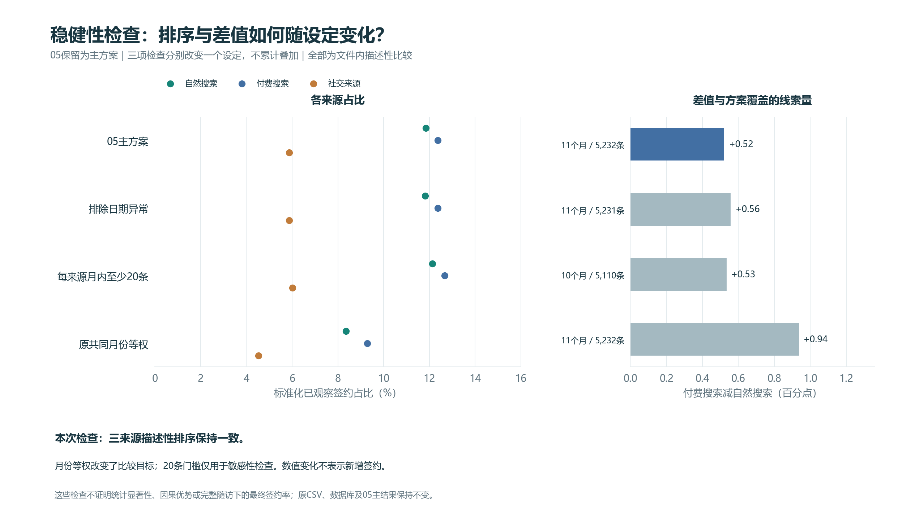

# 第十步：描述性稳健性分析

## 固定的四种方案

05为保留的主方案；下面三项检查各自相对主方案改变一个设定，不依次叠加。方案在本脚本中固定；这是探索后的描述性敏感性检查，并非预注册或独立确认性检验。

1. 主方案：三来源都有至少1条线索的共同月份，按合并线索月份构成加权。
2. 排除日期异常：只在本次计算中排除该整条MQL，分子与分母同时减少，再重算共同月份和权重；不把异常签约改成未签约，不删除原始记录。
3. 每来源月内至少20条：该月三个来源分别达到门槛才进入汇总，只按线索分母筛选；20条并非统计充分性的保证，也不根据签约数挑月份。
4. 原共同月份等权：使用主方案共同月份与原始记录，每月权重1／共同月份数，目标变为“各月份同等重要”。

## 结果对照

| 方案 | 月份数 | 三来源合并线索数 | 自然搜索 | 付费搜索 | 社交来源 | 付费−自然（百分点） |
| --- | ---: | ---: | ---: | ---: | ---: | ---: |
| 05主方案 | 11 | 5,232 | 11.85% | 12.37% | 5.87% | +0.52 |
| 排除日期异常 | 11 | 5,231 | 11.81% | 12.37% | 5.87% | +0.56 |
| 每来源月内至少20条 | 10 | 5,110 | 12.13% | 12.67% | 6.01% | +0.53 |
| 原共同月份等权 | 11 | 5,232 | 8.36% | 9.29% | 4.53% | +0.94 |

在所检查的三种设定中，描述性排序保持一致：付费搜索＞自然搜索＞社交来源。
差值幅度会随比较范围与权重目标改变。不能由这些有限检查宣布“彻底稳健”、统计显著或渠道因果优势。

## 分母、月份与权重目标

### 05主方案

三来源共同月份的合并线索月份构成。
纳入月份：2017-07, 2017-08, 2017-09, 2017-10, 2017-11, 2017-12, 2018-01, 2018-02, 2018-03, 2018-04, 2018-05。
三来源中未纳入的月份：无。
各来源分母：自然搜索 2296条、匹配签约271条；付费搜索 1586条、匹配签约195条；社交来源 1350条、匹配签约75条。

| 月份 | 三来源共用权重 |
| --- | ---: |
| 2017-07 | 2.3318% |
| 2017-08 | 4.7018% |
| 2017-09 | 3.7844% |
| 2017-10 | 5.2943% |
| 2017-11 | 5.4664% |
| 2017-12 | 2.5612% |
| 2018-01 | 14.2202% |
| 2018-02 | 12.5956% |
| 2018-03 | 14.1628% |
| 2018-04 | 18.0810% |
| 2018-05 | 16.8005% |

未舍入权重之和为1；表中展示值舍入后可能不恰好合计100%。

### 排除日期异常

仅排除异常整条MQL后，重新计算合并线索月份构成。
纳入月份：2017-07, 2017-08, 2017-09, 2017-10, 2017-11, 2017-12, 2018-01, 2018-02, 2018-03, 2018-04, 2018-05。
三来源中未纳入的月份：无。
各来源分母：自然搜索 2295条、匹配签约270条；付费搜索 1586条、匹配签约195条；社交来源 1350条、匹配签约75条。

| 月份 | 三来源共用权重 |
| --- | ---: |
| 2017-07 | 2.3323% |
| 2017-08 | 4.7027% |
| 2017-09 | 3.7851% |
| 2017-10 | 5.2954% |
| 2017-11 | 5.4674% |
| 2017-12 | 2.5617% |
| 2018-01 | 14.2229% |
| 2018-02 | 12.5980% |
| 2018-03 | 14.1464% |
| 2018-04 | 18.0845% |
| 2018-05 | 16.8037% |

未舍入权重之和为1；表中展示值舍入后可能不恰好合计100%。

### 每来源月内至少20条

仅保留三来源各有至少20条线索的月份，重新计算合并权重。
纳入月份：2017-08, 2017-09, 2017-10, 2017-11, 2017-12, 2018-01, 2018-02, 2018-03, 2018-04, 2018-05。
三来源中未纳入的月份：2017-07。
各来源分母：自然搜索 2242条、匹配签约271条；付费搜索 1530条、匹配签约195条；社交来源 1338条、匹配签约75条。

| 月份 | 三来源共用权重 |
| --- | ---: |
| 2017-08 | 4.8141% |
| 2017-09 | 3.8748% |
| 2017-10 | 5.4207% |
| 2017-11 | 5.5969% |
| 2017-12 | 2.6223% |
| 2018-01 | 14.5597% |
| 2018-02 | 12.8963% |
| 2018-03 | 14.5010% |
| 2018-04 | 18.5127% |
| 2018-05 | 17.2016% |

未舍入权重之和为1；表中展示值舍入后可能不恰好合计100%。

### 原共同月份等权

沿用原共同月份，各月份同等重要，不按线索量加权。
纳入月份：2017-07, 2017-08, 2017-09, 2017-10, 2017-11, 2017-12, 2018-01, 2018-02, 2018-03, 2018-04, 2018-05。
三来源中未纳入的月份：无。
各来源分母：自然搜索 2296条、匹配签约271条；付费搜索 1586条、匹配签约195条；社交来源 1350条、匹配签约75条。

| 月份 | 三来源共用权重 |
| --- | ---: |
| 2017-07 | 9.0909% |
| 2017-08 | 9.0909% |
| 2017-09 | 9.0909% |
| 2017-10 | 9.0909% |
| 2017-11 | 9.0909% |
| 2017-12 | 9.0909% |
| 2018-01 | 9.0909% |
| 2018-02 | 9.0909% |
| 2018-03 | 9.0909% |
| 2018-04 | 9.0909% |
| 2018-05 | 9.0909% |

未舍入权重之和为1；表中展示值舍入后可能不恰好合计100%。

## 对业务结论的影响

现阶段可说：在本次检查的设定下，三个来源的描述性排序没有改变；付费与自然搜索的差值大小依赖比较目标。仍需来源质量、全体线索跟进状态与真实成本数据，才能进一步讨论业务动作。
原始文件中未匹配签约的记录不等于最终失败。月份标准化和这些敏感性检查都没有统一完整随访时长。

## 图表



## SQL学习重点

- settings用VALUES列出方案参数，CROSS JOIN让同一来源数据分别进入各方案。
- HAVING同时检查三个来源是否都存在、月内最小分母是否达到门槛。
- PARTITION BY scenario分别计算各方案的总量和月份数。
- weighted_contribution_pp是每月对标准化百分比的贡献，按方案和来源求和得到最终结果。

实际SQL如下；10_sensitivity_details.csv和JSON保留全部方案×月份×来源明细及未舍入数值。

```sql
-- 四种分别比较的设定，不累计叠加；保留05主方案。
-- exclude_date_issue=1：整条异常线索不进入本次分子和分母，再重算权重。
-- minimum_month_n=20：每个来源在该月分别至少20条；不按签约数筛选。
-- equal_month_weight=1：各共同月份等权，改变描述性比较的目标。
WITH settings(scenario, exclude_date_issue, minimum_month_n, equal_month_weight) AS (
    VALUES ('baseline', 0, 1, 0),
           ('exclude_date_issue', 1, 1, 0),
           ('min_month_n20', 0, 20, 0),
           ('equal_months', 0, 1, 1)
),
selected_channels(channel) AS (
    VALUES ('organic_search'), ('paid_search'), ('social')
),
monthly AS (
    SELECT s.scenario, l.first_contact_month AS contact_month,
           l.origin_group AS channel, COUNT(*) AS lead_count,
           SUM(l.has_observed_won) AS observed_won_count,
           SUM(l.date_order_issue) AS date_issue_count
    FROM lead_overview AS l
    CROSS JOIN settings AS s
    WHERE l.origin_group IN (SELECT channel FROM selected_channels)
      AND (s.exclude_date_issue = 0 OR l.date_order_issue = 0)
    GROUP BY s.scenario, l.first_contact_month, l.origin_group
),
common_months AS (
    SELECT m.scenario, m.contact_month
    FROM monthly AS m
    JOIN settings AS s ON m.scenario = s.scenario
    GROUP BY m.scenario, m.contact_month
    HAVING COUNT(*) = (SELECT COUNT(*) FROM selected_channels)
       AND MIN(m.lead_count) >= MAX(s.minimum_month_n)
),
pooled AS (
    SELECT m.scenario, m.contact_month, SUM(m.lead_count) AS pooled_lead_count
    FROM monthly AS m
    JOIN common_months AS c
      ON m.scenario = c.scenario AND m.contact_month = c.contact_month
    GROUP BY m.scenario, m.contact_month
),
weights AS (
    SELECT p.scenario, p.contact_month, p.pooled_lead_count,
           CASE WHEN s.equal_month_weight = 1
                THEN 1.0 / COUNT(*) OVER (PARTITION BY p.scenario)
                ELSE 1.0 * p.pooled_lead_count / SUM(p.pooled_lead_count) OVER (PARTITION BY p.scenario)
           END AS month_weight
    FROM pooled AS p
    JOIN settings AS s ON p.scenario = s.scenario
)
SELECT m.scenario, m.contact_month, m.channel, m.lead_count,
       m.observed_won_count, m.date_issue_count, w.pooled_lead_count,
       w.month_weight,
       100.0 * m.observed_won_count / m.lead_count AS observed_won_pct,
       100.0 * w.month_weight * m.observed_won_count / m.lead_count AS weighted_contribution_pp
FROM monthly AS m
JOIN weights AS w ON m.scenario = w.scenario AND m.contact_month = w.contact_month
ORDER BY m.scenario, m.contact_month, m.channel;
```

数据来源与许可见[data/raw/SOURCE.md](../data/raw/SOURCE.md)。原CSV、数据库、03练习SQL及01—09报告未改。
